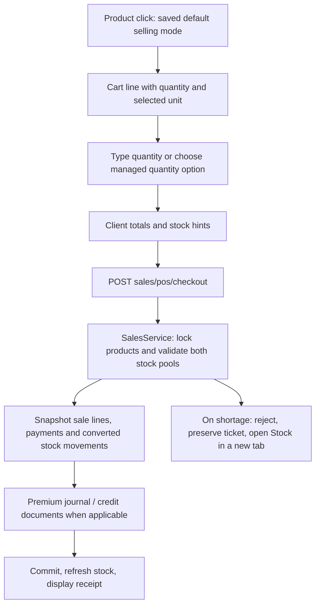

# Inventory and POS developer guide

This guide explains the inventory/POS implementation introduced in commit `113e4df`, including the simplified ticket UI and option-based quantity increments. Start here when modifying stock, purchases, product setup, checkout or returns.

For production SQL and installation order, read [Inventory workflow deployment](INVENTORY_WORKFLOW_DEPLOYMENT.md). This guide describes the current implementation, not a proposal.

## 1. The inventory model

Products have one base unit, such as `kg`, `litre` or `pcs`. A package-enabled product also has a package name, capacity and selling price. For example, Sokor can have base unit `kg`, package name `Loor`, and capacity `50`.

There is no separate database `stock_type` column. The product form sends Sealed/Non-Sealed as a validation choice; persisted package configuration determines whether sealed stock is supported. Non-Sealed products have no package configuration. Sealed product configuration currently requires base unit `kg` or `litre`.

Three quantities explain package stock:

```text
total_base = stock_levels.quantity
sealed_count = SUM(package_movements.package_change) for branch + product
opened_base = total_base - sealed_count * products.package_size
```

`opened_base` is derived, not a separate stock balance column. For a non-sealed product, the main balance is simply `total_base`.

### Example: Sokor, 50 kg per Loor

| Action | Sealed Loor | Opened kg | Total kg |
|---|---:|---:|---:|
| Receive 50 Loor | 50 | 0 | 2,500 |
| Manually open 2 Loor | 48 | 100 | 2,500 |
| Sell 0.25 kg | 48 | 99.75 | 2,499.75 |
| Sell 1 sealed Loor | 47 | 99.75 | 2,449.75 |
| Increase opened stock by 1 kg | 47 | 100.75 | 2,450.75 |
| Increase sealed stock by 1 Loor | 48 | 100.75 | 2,500.75 |

Opening a package is a transfer between the two pools. It creates no stock gain, purchase, sale or accounting value change. An adjustment represents a real count correction, gain or loss and changes value at cost.

### Invariants to preserve

- Total stock movements and the cached total balance must agree, allowing for legacy imported opening quantities that predate movement logging.
- Sealed counts must not become negative; opened stock must not become negative through supported sale/adjustment/return operations.
- Loose sales consume opened stock only. Sealed sales consume sealed packages only.
- Package opening is manual. POS must not automatically open a package to complete a loose sale.
- Sealed counts are whole numbers. Base quantities allow up to three decimals.
- Existing base stock must never be guessed to represent sealed packages.

## 2. Storage and source ownership

| Table / fields | Meaning | Main code |
|---|---|---|
| `products.unit`, `package_unit`, `package_size`, `package_price` | Base unit and optional sealed configuration | [InventoryCatalogService](../app/Services/Web/InventoryCatalogService.php) |
| `products.sell_price`, `cost_price` | Selling price and average cost per base unit | Catalog / receiving services |
| `products.default_sale_mode`, `selling_group_id` | Saved POS default and optional reusable quantity group | Catalog / [SellingOptionsService](../app/Services/Web/SellingOptionsService.php) |
| `stock_movements` | Signed base-unit inventory movements | [InventoryService](../app/Services/InventoryService.php) |
| `stock_levels` | Cached base quantity per branch + product | InventoryService |
| `package_movements` | Signed sealed-package count; capacity, reason, actor and references | [PackageInventoryService](../app/Services/PackageInventoryService.php) |
| `sale_items`, `purchase_items` | Selected-unit quantity and price, plus `stock_mode`, `stock_factor`, `unit_label` snapshots | Sales / purchase order services |
| `selling_option_groups.options_json` | Ordered labels and base quantities; no prices | SellingOptionsService |
| `product_opening_stocks` | Initial sealed/opened amounts and cost/value snapshot | [OpeningStockService](../app/Services/Web/OpeningStockService.php) |
| `web_stock_adjustment_details` | Request key, reason, chosen pool, selected quantity and unit | [StockAdjustmentService](../app/Services/Web/StockAdjustmentService.php) |

Quantities are branch-scoped. `products.cost_price` is currently shared on the product, not stored separately per branch. Receiving uses the receiving branch's on-hand quantity in the existing weighted-average calculation. A future branch-specific costing change needs its own design and reconciliation tests; do not assume the current schema stores branch-specific costs.

## 3. Product setup and initial stock

The web path is:

```text
Products form -> POST inventory/products/save
 -> InventoryWebController::saveProduct()
 -> InventoryCatalogService::saveProduct()
 -> product + optional OpeningStockService::create()
 -> stock ledger/cache + package ledger + Premium opening journal
```

The product form shows package fields only for Sealed. Name, positive capacity and package selling price are then required. Server validation enforces the same rules. Products can optionally choose a matching active Selling Options group and a default `loose` or `sealed` selling mode.

Package name, capacity and base unit are protected after package history or sealed purchase lines exist. A different package capacity should be a separate product. Changing selling prices is still supported.

### Opening stock is different from opening a package

**Opening stock** means initial inventory already owned when creating a product:

- Non-Sealed: enter the main quantity and cost per main unit.
- Sealed: enter whole sealed packages, already-opened base quantity, and cost per sealed package. The opened portion uses the same derived base-unit cost.
- Stock entry requires `stock.adjust` permission and uses the authenticated user's current branch.
- Positive opening quantities require an explicit, non-negative cost; zero cost is allowed.
- Opening stock is entered at creation only. Editing an existing product cannot reset its initial stock. Use adjustments for later count corrections and Receiving for future supplier goods.

For example, 48 Loor + 100 kg, at $51 per 50 kg Loor:

```text
base cost = 51 / 50 = 1.02 per kg
total quantity = 48 * 50 + 100 = 2,500 kg
opening value = 2,500 * 1.02 = 2,550
```

Premium accounting uses the existing `AccountingService::postOpeningStock()` rule: debit Inventory, credit Owner's Capital. It does not create supplier debt or sales income.

Product creation and opening balances run in one transaction. An accounting error rolls everything back. The browser sends a `creation_request_key`; the stored request hash prevents the same retry from creating duplicate products/opening balances or being reused for different inputs.

## 4. Purchases and receiving

[PurchaseOrderService](../app/Services/Web/PurchaseOrderService.php) creates/edits an unreceived web purchase order. An order itself does not add stock or create a payable.

Each order line preserves the selected purchase unit:

```json
{
  "product_id": 123,
  "stock_mode": "sealed",
  "quantity": 50,
  "unit_cost": 51
}
```

For a 50 kg Loor, the stored line has `stock_factor = 50`, `unit_label = Loor`, quantity 50 and cost $51 per Loor. Its total is $2,550. A loose line uses factor 1 and a base-unit cost. Do not convert a line's quantity to kg without also changing its unit cost and document semantics.

[PurchaseReceiptService](../app/Services/PurchaseReceiptService.php) handles actual/partial receiving:

1. Lock the order and relevant products.
2. Validate remaining receivable quantities; sealed receipt quantities must be whole packages.
3. Use the order line's saved factor to calculate base quantity.
4. Reaverage base-unit cost using received base quantity and cost per base unit.
5. Add the base-unit stock movement and cached total; add sealed count for sealed lines.
6. Grow the supplier bill for goods actually received; Premium posts Inventory / Payable.
7. Update fulfillment status and commit everything together.

The purchase modal has a dedicated unit column. Products with one unit show plain unit text. The HTML number input sets both `min` and `step` to 1 for sealed units; retaining `min=0.001` with `step=1` would reject integers such as 50.

## 5. Manually opening packages

`POST inventory/stock/open-package` calls `PackageInventoryService::open()` and requires `stock.adjust`.

```json
{
  "product_id": 123,
  "quantity": 1,
  "request_key": "a-valid-client-generated-uuid"
}
```

Under the product lock, the service checks available sealed stock and records a negative package count with reason `open`. It deliberately does not change `stock_movements`, total quantity or accounting. Opened stock increases because it is derived from the new sealed count. Existing loose remnants are retained.

The request key is unique within the branch. An identical retry does not open more packages; changed inputs with the same key are rejected. The Stock screen displays a separate opening history with quantity, capacity, user and time.

## 6. Stock adjustments and low-stock alerts

The shared adjustment form sends signed quantity, selected `stock_mode`, reason and request key to `POST inventory/stock/adjust`.

For a package product, the operator must choose a pool:

| Mode | Meaning of +1 | Base movement | Package movement |
|---|---|---:|---:|
| `sealed` | One additional sealed package | +capacity | +1 |
| `loose` | One additional kg/litre | +1 | None |

Ordinary products adjust their main unit. Negative adjustments check the chosen pool; available sealed stock cannot satisfy a missing opened quantity. Sealed adjustment quantities must be whole numbers.

`StockAdjustmentService` stores the selected-unit metadata against the exact movement ID. Retries are checked before posting again. Ledger/cache, package changes, reason metadata and Premium Inventory / Inventory Adjustment journal commit together.

The `sealed_adjustment` reference type has a deliberate guard exception in `InventoryService::recordMovement()`: the caller has already validated sealed stock and changed its package count. Applying the loose-stock guard a second time would incorrectly reject a valid sealed decrease. Do not use this reference type to bypass stock validation in another caller.

For reorder alerts, package products compare sealed count with `reorder_level`; ordinary products compare their main balance. The threshold's unit appears in the UI. Opened stock exhaustion is a separate operational notice: the shop may have plenty of sealed stock but need to open another package.

## 7. How POS connects to inventory



[PosWebController](../app/Controllers/Web/PosWebController.php) loads products and stock splits. `GET sales/pos/stock-data` refreshes balances and active quantity groups, including when the browser regains focus after a stock-opening tab. [POS view/cart code](../app/Views/web/pos/index.php) owns the ticket state.

### Cart identity and quantity selection

A line is identified by `product_id:stock_mode`. The same product can appear as both kg and sealed Loor on one ticket. Adding the same product/mode accumulates its quantity.

A quantity group stores user-defined labels such as Rubac and their configured base quantities. The UI does not hard-code their values or prices. Its compact dropdown appears for loose-mode products with assigned options; unrelated products need no group.

Selecting an option replaces the line quantity and saves a local `quantity_option` containing its label and quantity:

```text
Configured Rubac = 0.25 kg
select Rubac -> 0.25
plus         -> 0.50, Rubac remains selected
plus         -> 0.75
minus        -> 0.50
```

The increment comes from the selected configuration, not from its name. If Rubac is configured as 0.3, its step is 0.3. Repeated increments round to three decimals to avoid drift.

Choosing the base-unit/custom option clears the named increment without changing the current total: for example, 0.5 kg then plus becomes 1.5 kg. Typing a custom quantity, changing the selling unit, or adding the product again resets the named increment. Sealed mode always steps by one whole package. Minus removes the line if its resulting quantity is zero or below.

The selected option is retained as a local snapshot while that line is in the ticket, even if a later stock refresh changes the managed group. The dropdown can display that saved choice until the cashier chooses another option or custom quantity. Fraction labels are not separate sale SKUs and are not stored as sale-line conversion factors.

### Checkout payload and authoritative validation

```json
{
  "uuid": "a-valid-checkout-uuid",
  "tax_id": null,
  "items": [
    {"product_id": 123, "stock_mode": "loose", "quantity": 0.5, "unit_price": 1.5, "discount": 0},
    {"product_id": 123, "stock_mode": "sealed", "quantity": 1, "unit_price": 60, "discount": 0}
  ],
  "payments": []
}
```

This is an illustrative payload, not a runnable sale: use a real current tax ID where configured, valid payments, and a registered customer for unpaid credit. Named quantity metadata is not submitted; the server receives the actual selected-unit quantity.

[SalesService](../app/Services/SalesService.php) validates active products, allowed modes, positive three-decimal quantities, whole sealed packages and available stock. It aggregates duplicate request lines by product/pool and checks the converted total too. Client-side hints never authorize a stock movement.

The server defaults price from `sell_price` or `package_price` when no explicit `unit_price` is supplied; the current service also accepts a validated explicit line price. It recomputes amounts and costs rather than trusting client totals. Do not document this as server-enforced catalog-only pricing.

For sealed lines, `base_quantity = quantity * stock_factor`; loose factor is 1. Base movements reduce total stock, and sealed lines also reduce the package ledger. Saved descriptions include the selected unit, and `cost_total` snapshots converted cost of goods.

The checkout UUID supports retry idempotency. A stock shortage returns a structured response (`PACKAGE_STOCK_SHORTAGE` on web checkout), leaves the ticket unchanged and offers the Stock page in a new tab. After manually opening a package, the cashier can retry. POS never opens stock automatically.

## 8. Costing, accounting and returns

Base cost is stored with six decimal places; document monetary amounts and journal postings are rounded to two. Purchase/sale prices on selected-unit lines remain document prices per selected unit. Do not multiply a package count by base cost without its stock factor.

| Operation | Premium accounting |
|---|---|
| Initial opening stock | Debit Inventory; credit Owner's Capital |
| Receive supplier goods | Debit Inventory; credit Payable |
| Open a package | No journal; total value unchanged |
| Stock adjustment | Inventory against Inventory Adjustment at cost |
| Sale | Payment/Receivable against Revenue/Tax; COGS against Inventory |
| Return | Existing return accounting reverses the appropriate financial effects |

[DocumentReturnService](../app/Services/DocumentReturnService.php) keeps return entitlement in the original selected unit and uses its immutable factor to move base stock. Customer returns restore the original pool; supplier returns consume the original pool and cannot remove more sealed stock than remains. Sealed returns are whole packages. Operators must only return physically sealed goods as sealed; the application does not inspect packaging condition.

## 9. Transactions, permissions and safe extension points

- `InventoryService::recordMovement()` owns base ledger/cache updates, but it does not create its own transaction. Callers must own the transaction and stock checks.
- `PackageInventoryService::record()` likewise assumes the caller holds the product row lock through commit. Do not call it as a standalone stock-changing endpoint.
- Product row locks serialize writers to the same product. Sales lock product IDs in order. Receiving/returns also coordinate document and party locks; preserve their established lock order when extending them.
- Multi-table financial operations use transactions. Do not commit a package count before a sale, receipt, adjustment or journal succeeds.
- Branch comes from authenticated context, not a caller-selected branch field in these forms.
- Product viewing/creation/editing uses existing product permissions; opening packages, initial stock entry and adjustments require `stock.adjust`; POS requires `sales.create`. Selling Options editing requires `products.edit`.
- Mobile/API controllers and `/api/v1` route definitions were left unchanged. Shared services now enforce package pools. Omitted `stock_mode` defaults to loose/base units for compatibility; a legacy client cannot use sealed stock for loose sales without manual opening.
- Package opening, creation and adjustment retries have their own request keys; checkout has its UUID. Do not assume every other endpoint has identical retry semantics.

The Select2 modal fix lives in [searchable-selects.js](../assets/js/searchable-selects.js): native dialog coordinates include scroll offsets, modal scrolling is not locked, and a dropdown leaving view closes without scrolling the user back. [POS layout CSS](../assets/css/pos-layout.css) scopes compact ticket controls to the order panel; mobile keeps readable touch controls. Preserve native keyboard interactions and the shared toaster/SweetAlert2 conventions.

## 10. Testing and onboarding

Run from the project root with PHP/Node available; on XAMPP, substitute `C:\xampp\php\php.exe` for `php`.

```sh
php tests/inventory_workflow_smoke.php
php tests/inventory_workflow_schema_smoke.php
php tests/packaged_inventory_smoke.php
node tests/packaged_inventory_ui_smoke.cjs
node tests/purchase_quantity_units_smoke.cjs
node tests/select2_modal_position_smoke.cjs
node tests/pos_tax_calculation_smoke.cjs
node tests/pos_checkout_print_smoke.cjs
```

| Test | What to study |
|---|---|
| [inventory_workflow_smoke.php](../tests/inventory_workflow_smoke.php) | Opening balances, sealed/opened adjustments, retry safety, reorder basis, Owner's Capital and inventory/book reconciliation |
| [inventory_workflow_schema_smoke.php](../tests/inventory_workflow_schema_smoke.php) | Production SQL parity and applying schema changes to temporary baseline tables without altering original records |
| [packaged_inventory_smoke.php](../tests/packaged_inventory_smoke.php) | Rice/oil purchase-to-receipt-to-sale scenarios, manual opening, fractions, shortages, returns and accounting rollback |
| [packaged_inventory_ui_smoke.cjs](../tests/packaged_inventory_ui_smoke.cjs) | Mixed-unit cart, managed option steps, custom-unit reset, decimal precision and shortage guards |
| [purchase_quantity_units_smoke.cjs](../tests/purchase_quantity_units_smoke.cjs) | Correct native number-input min/step for whole packages |
| [select2_modal_position_smoke.cjs](../tests/select2_modal_position_smoke.cjs) | Scrolled-dialog dropdown geometry and modal scroll handling |

PHP financial tests use connection-local temporary tables and compare original table fingerprints afterward. Do not move these scenarios into real stock, sale, purchase or journal tables. Generated test data disappears when the connection closes; the source tests stay committed.

Read-only previews can be generated with `php tests/packaged_inventory_smoke.php --preview-pos` (also `--preview-products`, `--preview-stock`, `--preview-selling`, `--preview-purchases`). They render production views with temporary test data, block saving, and write HTML into ignored `results/packaged-inventory/`. They are not live inventory and are not proof of a production checkout.

Suggested reading order: schema patches 17/18, PackageInventoryService, InventoryService, InventoryCatalogService/OpeningStockService, PurchaseOrderService/PurchaseReceiptService, SalesService, then the POS view and its UI tests.

Before merging stock changes, verify both pools, quantities and valuation; partial receiving; duplicate submissions; a shortage with sealed stock still available; mixed-unit tickets; returns; and full rollback after a financial failure. Keep the deployment SQL and canonical tenant schema files in sync.

## Bulk Excel creation

See [Excel imports](EXCEL_IMPORTS.md) for product, supplier and customer templates, whole-file validation, opening stock, transaction boundaries, deployment and isolated regression tests.
